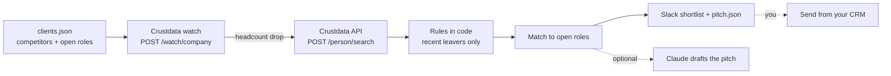

# Competitor Layoff Pitch Builder (Open Source, Slack Alerts for Recruiting Agencies)

**An open-source Python tool that watches your clients' competitors for headcount drops, lists the people who just left them, matches those people to your client's open roles and drafts the pitch email.**

When a competitor shrinks, strong people reach the market all at once, and most agencies hear about it after the best of them are placed. This tool runs the check for you: a [Crustdata](https://crustdata.com) company watch flags the headcount drop, a person search lists the recent leavers, and a scoring step in code matches them to the open roles. [Crustdata](https://crustdata.com) is the people and company data layer ([API docs](https://docs.crustdata.com)).

## How it works



1. **Watch.** `python3 pitch.py watch` creates one company watch over every competitor domain. It tracks `headcount.total` with the `decreased` condition. Without a webhook it is pull-only: read its runs from the Crustdata API.
2. **Search.** For each competitor, `POST /person/search` filters on past employer domain, `end_date` since N days ago and `recently_changed_jobs`.
3. **Filter.** Search filters on nested roles can each match a different role, so `qualify()` re-checks on one role. Each rule has a unit test:
   - no current role at the competitor,
   - a past role at the competitor,
   - that role ended inside the window and not in the future.
4. **Match.** `match()` scores every leaver against every open role: title and headline keywords (2 points each, max 4), same function (2), same seniority (1), same country (1). Anything under `--min-score` (default 3) is dropped.
5. **Alert.** People who already have a new role are left out unless you pass `--include-placed`. New items only (`.state/seen.json`), Slack text with no names, full detail in `out/pitches.json`.
6. **Draft.** A plain template by default, Claude with `--claude`.

The last step, sending the pitch and the shortlist from your CRM (HubSpot or any other), is yours: `out/pitches.json` has one pitch and one shortlist per client.

## Quickstart

Requires Python 3.9+. No dependencies for the core tool.

```bash
git clone https://github.com/mhimed-crustdata/competitor-layoff-pitch-builder
cd competitor-layoff-pitch-builder
make setup        # creates .env, then add your CRUSTDATA_API_KEY
cp examples/clients.example.json clients.json   # your clients, competitors, open roles
make watch        # creates the competitor headcount watch
make demo         # runs the leaver search, never posts to Slack
make run          # posts new shortlists to SLACK_WEBHOOK_URL
make test         # unit tests, no network
```

`python3 pitch.py watch --dry-run` prints the watch request without sending it. When a watch fires for some competitors, run `python3 pitch.py pitch --only-domains intel.com,amd.com` to search only those.

Run it weekly with cron (`0 8 * * 1 cd /path/to/repo && make run`) or a scheduled CI job with your keys stored as secrets.

## Configuration

| Variable | Default | What it does |
|---|---|---|
| `CRUSTDATA_API_KEY` | required | Your Crustdata API key. Read from the environment only |
| `SINCE_DAYS` | `45` | How far back a leaver counts as "just left" |
| `WATCH_WEBHOOK_URL` | empty | Where the company watch posts events. Empty means pull-only |
| `SLACK_WEBHOOK_URL` | empty | Slack incoming webhook. Empty means no Slack post |
| `ANTHROPIC_API_KEY` | empty | Optional Claude step |
| `ANTHROPIC_MODEL` | `claude-opus-5-5` | Model for the optional Claude step |

`clients.json` holds, per client: `name`, `contact`, `competitors` (domains) and `open_roles` (`title`, `keywords`, optional `function`, `seniority`, `country`). See [examples/clients.example.json](examples/clients.example.json).

Output files in `out/` contain personal data and are git-ignored.

## Example output

A real run on 2026-10-29 against the live API for one large public chip maker, leavers since 2026-08-01, first 100 rows of the search. Individuals are not shown. Aggregated from the scan:

```json
{
  "search_matches_before_rules": 3462,
  "rows_scanned": 100,
  "passed_rules": 15,
  "rejected": {"left_before_window": 78, "still_employed_at_competitor": 6, "other": 1},
  "left_in": {"2026-08": 9, "2026-09": 6},
  "has_new_role": 11,
  "available_now": 4,
  "by_function": {"Engineering": 3, "Operations": 2, "Sales": 2, "other / unknown": 8},
  "by_seniority": {"Director": 6, "Entry Level": 4, "other": 5},
  "by_country": {"United States": 12, "other": 3}
}
```

The nested-role problem is real: only 15 of 100 rows survive the rules, which is why `qualify()` exists. Most people who left have already started a new role, so check the watch often.

What the Slack alert looks like (redacted):

```text
:bell: 3 candidates ready to pitch
*Example Semiconductor Co*: 3 matches from 2 competitors
• [Name], [Title], left [Company] [YYYY-MM] -> Senior Firmware Engineer (score 5)
```

## How to build a competitor layoff pitch agent

1. **Define the signal as data.** A competitor's `headcount.total` going down, plus people whose role at that competitor ended recently.
2. **Choose the documented Crustdata calls.** `POST /watch/company` for the drop, `POST /person/search` for the leavers.
3. **Write the rules in code, not in a prompt.** Re-check nested matches on the same role.
4. **Only alert on what's new.** Keep a seen-set per client and person.
5. **Use the model for the words, not the list.** Scoring is deterministic. Claude only writes the email.
6. **Push it where people work.** Slack for the recruiter's review, your CRM for the send.

## FAQ

**How do recruiting agencies find candidates after layoffs?**
Watch the headcount of your clients' competitors, then search for people whose role at those competitors ended recently. This tool automates both steps with Crustdata and ranks the leavers against your client's open roles.

**Why does the code re-check the search results?**
Person search filters on past roles, end date and employer can each match a different role of the same person. `qualify()` checks that one role at the competitor ended inside the window and that the person has no current role there.

**Does it contact anyone?**
No. It only posts to your own Slack webhook when `SLACK_WEBHOOK_URL` is set and `--dry-run` is off. The pitch is a file for you to send.

**Is Claude required?**
No. It is optional and off unless `ANTHROPIC_API_KEY` is set and you pass `--claude`.

**Which Crustdata endpoints does it use?**
`POST /watch/company` and `POST /person/search` on API version `2025-11-01`. See the [Crustdata API docs](https://docs.crustdata.com).

## Project layout

```text
pitch.py            # watch, search, qualify, match, draft
crustdata_api.py    # tiny Crustdata client (stdlib only)
notify.py           # optional Slack + Claude
examples/           # clients.example.json
tests/              # unit tests, no network
```

## License

MIT. See [LICENSE](LICENSE). Data layer: [Crustdata](https://crustdata.com) ([docs](https://docs.crustdata.com)).
